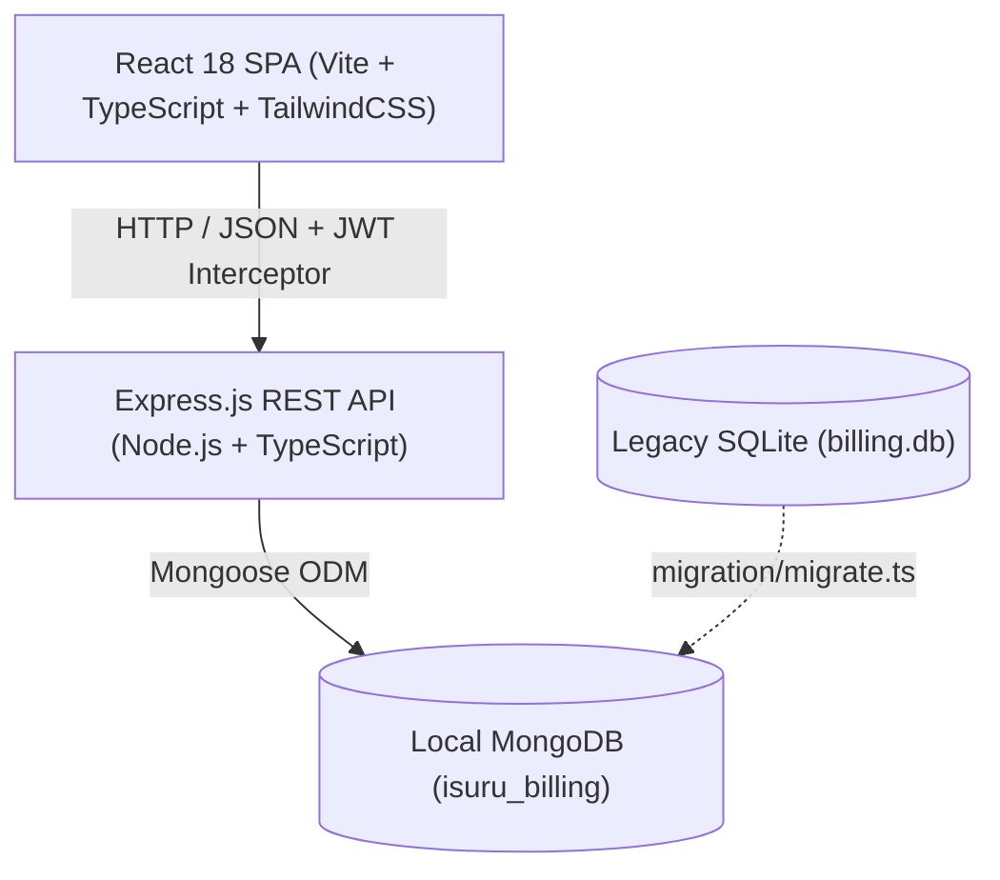

# ISURU Service Center - Billing & Workshop Management System (MERN Stack)

> Complete, production-ready full-stack enterprise migration of the ISURU Service Center Billing System from legacy Windows Forms & ASP.NET Core MVC (SQLite) to a modern, responsive, offline-capable **MERN Stack** (MongoDB, Express, React, Node.js + TypeScript).

---

## 1. Project Overview

The ISURU Service Center Billing System is a business management and point-of-sale platform tailored for automotive service center operations. It provides high-speed counter POS invoicing, live vehicle and customer registration, inventory tracking with automated stock decrements, frozen buying-cost accounting, supplier accounts payable ledgers, and an itemized Profit & Loss statement.

### Key Achievements in MERN Rebuild
- **100% Feature Parity:** Every single workflow, form, database table, calculation, invoice layout, and validation rule from both legacy C# Windows Forms and ASP.NET Core Web apps has been ported and enhanced.
- **Offline Capable:** Runs 100% locally with local MongoDB, local Express API (`:5050`), and Vite React SPA (`:5173`). No external cloud dependencies required.
- **Production Performance:** TypeScript on both backend and frontend, strict validation with Zod, hashed passwords with bcrypt, token-based authentication with role guarding (`Admin` vs `User`).
- **Real-Time Stock & Cost Freezing:** Item sales automatically decrement stock inventory and freeze the product's purchase cost (`buying_price`) onto the invoice row for accurate financial auditing.
- **Dual Printing Formats:** One-click instant switching between standard A4 Tax Invoices and 58mm/80mm Thermal POS receipt rollback format.

---

## 2. System Architecture & Tech Stack



### Backend (`/backend`)
- **Runtime:** Node.js (ES Modules, TypeScript 5.7)
- **Framework:** Express.js 4.21
- **Database / ODM:** MongoDB & Mongoose 8.9
- **Security:** `bcryptjs` password hashing, `jsonwebtoken` (JWT), HTTP-only cookies, CORS
- **File Uploads:** `multer` for official workshop logos
- **Testing:** `vitest` integration test suite with 18 comprehensive tests

### Frontend (`/frontend`)
- **Framework:** React 18 with Vite 6
- **Routing:** `react-router-dom` v7 with role-guarded `ProtectedRoute`
- **Styling:** TailwindCSS 3.4 with custom `@media print` typography
- **State & Caching:** Zustand for authentication session, `@tanstack/react-query` for data fetching
- **Charts:** `recharts` for 30-day daily sales trend and payment distribution
- **Icons:** `lucide-react`

---

## 3. User Roles & Default Credentials

| Role | Default Username | Default Password | Permissions |
|---|---|---|---|
| **Administrator** | `Isuru@6800` | `Isuru@service` | Full system access, service rate catalog editing, financial profit statement, settings & credentials, data purge |
| **Service Staff** | `User@123` | `User@service` | High-speed POS counter billing, view invoices, customer search, inventory lookup |

*Note: Credentials can be updated at any time by the Administrator in **Settings > Security & Passwords**.*

---

## 4. Quick Start & Local Execution

### Prerequisites
1. **Node.js**: v18.0.0 or higher (`node -v`)
2. **MongoDB**: Local MongoDB community edition running on default port `27017` (`mongod`)

### Step 1: Install Dependencies
From the repository root:
```bash
npm install
cd backend && npm install
cd ../frontend && npm install
cd ..
```

### Step 2: Migrate Legacy SQLite Data (Optional / Verified)
To populate MongoDB with data from the legacy SQLite database:
```bash
npm run migrate
```
*A detailed validation report is saved to `docs/migration-report.md`.*

### Step 3: Run Automated Test Suite
Run the 18 integration tests against the local API:
```bash
npm test
```

### Step 4: Run the Development System
Start both backend (`http://localhost:5050`) and frontend (`http://localhost:5173`) concurrently:
```bash
npm run dev
```
Open your browser and navigate to:
**`http://localhost:5173`**

### Step 5: Production Build & Run
To compile both TypeScript packages:
```bash
npm run build
npm start
```

---

## 5. POS Counter Keyboard Shortcuts

The POS Billing Counter (`/billing`) is optimized for rapid checkout using hardware keyboard hotkeys:

- **`F2`**: Append a new service or inventory item line to the active bill.
- **`Ctrl+S` / `Cmd+S`**: Save the current invoice, deduct stock, freeze cost basis, and automatically launch the Print Preview modal.
- **`Escape`**: Dismiss active modals or clear selection.

---

## 6. Financial Calculations & Accounting Logic

1. **Item Line Amount:**
   $$\text{Amount} = \text{Quantity} \times \text{Rate}$$

2. **Invoice Subtotal & Grand Total:**
   $$\text{Subtotal} = \sum \text{Amount}$$
   $$\text{Grand Total} = \text{Subtotal} - \text{Discount}$$
   *(where $0 \le \text{Discount} \le \text{Subtotal}$)*

3. **Profit & Loss Statement (Admin View):**
   - **Labour Service Revenue:** Sum of line amounts where item is labour (no `itemId`).
   - **Parts Revenue:** Sum of line amounts where `itemId` is present in inventory.
   - **Cost of Goods Sold (COGS):** Sum of $(\text{Quantity} \times \text{Buying Price})$ frozen at sale time.
   - **Gross Profit:**
     $$\text{Gross Profit} = \text{Total Sales Revenue} - \text{COGS}$$
   - **Gross Margin Percentage:**
     $$\text{Profit Margin} = \left(\frac{\text{Gross Profit}}{\text{Total Sales Revenue}}\right) \times 100$$
   - **Net Profit After Purchases:**
     $$\text{Net Profit} = \text{Gross Profit} - \text{Total Purchases (Supply Invoices)}$$

---

## 7. Project Structure

```
ISURU Service/
├── backend/                  # Express.js REST API Server
│   ├── src/
│   │   ├── config/           # Database & environment constants
│   │   ├── middleware/       # JWT Auth & error handlers
│   │   ├── models/           # Mongoose schemas (Customer, Invoice, Product, etc.)
│   │   ├── modules/          # Business domain controllers & routers
│   │   │   ├── auth/
│   │   │   ├── customers/
│   │   │   ├── dashboard/
│   │   │   ├── inventory/
│   │   │   ├── invoices/
│   │   │   ├── profit/
│   │   │   ├── services/
│   │   │   ├── settings/
│   │   │   ├── suppliers/
│   │   │   ├── supplyInvoices/
│   │   │   └── vehicles/
│   │   ├── app.ts            # Express application setup
│   │   └── server.ts         # Server entrypoint (Port 5050)
│   ├── tests/                # 18 Vitest Integration API tests
│   └── package.json
│
├── frontend/                 # React 18 SPA (Vite + TailwindCSS)
│   ├── src/
│   │   ├── app/              # Router & QueryClient application shell
│   │   ├── components/       # Layouts, UI modals, badges, print dialogs
│   │   ├── pages/            # 10 production application pages
│   │   │   ├── LoginPage.tsx
│   │   │   ├── DashboardPage.tsx
│   │   │   ├── BillingPage.tsx
│   │   │   ├── InvoicesPage.tsx
│   │   │   ├── CustomersPage.tsx
│   │   │   ├── ServicesPage.tsx
│   │   │   ├── InventoryPage.tsx
│   │   │   ├── SuppliersPage.tsx
│   │   │   ├── SupplyInvoicesPage.tsx
│   │   │   ├── ProfitStatementPage.tsx
│   │   │   └── SettingsPage.tsx
│   │   ├── services/         # Axios API client with token interceptor
│   │   ├── store/            # Zustand auth state store
│   │   └── types/            # Shared TypeScript data models
│   └── package.json
│
├── migration/                # SQLite to MongoDB migration engine
│   └── migrate.ts
│
├── docs/                     # Comprehensive architecture and analysis docs
│   ├── database-design.md
│   ├── existing-features.md
│   ├── feature-parity-matrix.md
│   ├── implementation-plan.md
│   ├── migration-report.md
│   └── original-system-analysis.md
│
├── package.json              # Root workspace orchestrator
└── README.md                 # System documentation
```

---

## 8. License & Ownership
Copyright © 2026 ISURU Service Center. All rights reserved.
Developed for internal workshop billing, accounting, and inventory management.

